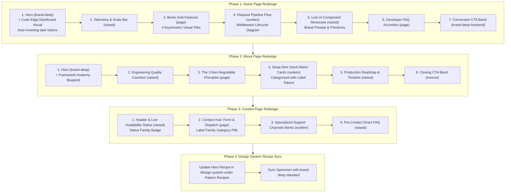

# Public Pages Redesign Plan (Home, About, Contact & Hero Sync)

**Status:** Completed (Phases 1–4 fully implemented and verified against all quality gates)  
**Target Files:**
- `app/routes/home.tsx` (Phase 1)
- `app/routes/about.tsx` (Phase 2)
- `app/routes/contact.tsx` (Phase 3)
- `app/routes/design-system.tsx` (Phase 4 — Hero recipe specimen only)  
**Related Components & Patterns:** `app/components/patterns/Hero.tsx`, `app/components/patterns/Section.tsx`, `app/components/patterns/SectionHeading.tsx`, `app/components/patterns/CtaBand.tsx`, `app/components/patterns/FeatureCard.tsx`, `app/components/patterns/IconTile.tsx`, `app/components/patterns/CodeBlock.tsx`, `app/components/patterns/LogoStrip.tsx`  
**Guardrails:** `scripts/check-design-system.mjs` (Rules 1–16), `tests/design-tokens.test.ts`, `e2e/a11y.spec.ts`, `e2e/visual.spec.ts`, `AGENTS.md`, `DESIGN.md`

---

## 1. Executive Summary & Design Direction

### The Problem
The current public pages (`home.tsx`, `about.tsx`, `contact.tsx`) suffer from severe visual monotony:
- **Text-heavy and low visual interest**: Sections rely almost entirely on plain paragraphs, bullet lists, and basic icon tiles with no rich UI visuals or product representation.
- **Surface monotony**: The vast majority of sections sit on a single light-gray canvas (`bg-background` / `sunken`), failing to leverage the 5-tone surface ladder established in the design system (`brand-deep`, `raised`, `page`, `sunken`, `inverse`).
- **Underwhelming Hero sections**:
  - The Home page hero currently renders on a light background with a plain terminal snippet.
  - The About page doesn't even use the `Hero` component, relying instead on a plain text `PageHeader`.
  - Neither hero communicates the premium, edge-ready power of a modern Supabase + Cloudflare Workers stack.

### The Solution
Completely revamp all three public pages using design intelligence from top-tier developer platforms and SaaS leaders (such as **Linear**, **Supabase**, **Stripe**, **Raycast**, and **Vercel**), built entirely with our semantic tokens and upstream shadcn UI primitives:
1. **Dynamic Tone Cadence & Surface Ladder**: Alternate intentionally across `brand-deep` (hero), `raised` (telemetry/benchmarks), `page` (spacious bento grid), `sunken` (recessed architecture pipeline), and `inverse` (closing CTA band on About/Contact; Home instead closes on a `brand-deep` bookend).
2. **Hero Sections on `brand-deep`**: Anchor both Home and About pages with a high-impact, full-bleed `Section tone="brand-deep"` hero (the body's single large brand surface under `AGENTS.md` Rule 3; Home's closing CTA bookend is the rule's only exception).
3. **Pure Code UI Visuals (HTML/JSX)**: In place of external bitmap assets (preserving zero-bloat and edge streaming speed), build high-fidelity UI visual components directly in JSX/CSS tokens:
   - macOS-style edge dashboard window mockup with traffic lights, real-time latency badges, and telemetry cards.
   - Interactive request pipeline architecture flowcharts.
   - Token ramp swatch inspectors and live component playgrounds.
   - Framework anatomy blueprint diagram.
   - Maintainer status dashboard and interactive inquiry topic pills.
4. **Hero Pattern Recipe Sync (Phase 4)**: Once Home and About heroes are revamped, update the `Hero` recipe specimen under *Nine Reusable Layout Pattern Recipes* in `app/routes/design-system.tsx` to match the new `brand-deep` standard.
5. **Rigorous Quality Gates**: Mechanical compliance with `check:ds` (all 16 rules), TypeScript strictness, vitest unit tests, Playwright automated axe accessibility tests (`e2e/a11y.spec.ts`), and Windows visual regression snapshots (`e2e/visual.spec.ts`).

---

## 2. Alignment with Updated `DESIGN.md` & `AGENTS.md` Constraints

Following the recent major update to `DESIGN.md`, this plan incorporates the following strict rules:

### A. Single-Primary Default & Restricted Brand Accent Scope (Rule 4)
- **Single-Primary Default**: The starter defaults to a Single-Primary brand architecture (`siteThemeConfig.enableAccent = false` in `app/config/theme.ts`). In this mode, `--brand-accent` automatically aliases to `--primary`.
- **Strictly Restricted Scope**: When chromatic accent is enabled (`enableAccent = true`), its scope is restricted to **tiny punctuation only**: an 8px indicator dot or small status pill tag.
- **Hard Anti-Patterns**:
  - **NEVER use `--brand-accent` on buttons (`<Button>`).** Primary CTAs must always use `bg-primary` or neutral outlines.
  - **NEVER use `--brand-accent` as a background or border on cards, hero backgrounds, or large surfaces.**
  - Neutral components (`--secondary`, `--accent`) must remain neutral controls (`#f3f3f3` light / `#262626` dark); never tint them to improvise an accent.

### B. Scoped Subtrees & Theme Islands (Zero-Drift Auto-Inversion) (Section 6)
- **Auto-Inverting Dark Tones**: `Section tone="brand-deep"` automatically embeds the `dark` class in `SECTION_TONES["brand-deep"]`. Descendant elements (`<SectionHeading>`, `<Button variant="outline">`, `<Card>`, and muted copy `text-foreground-muted`) automatically resolve to accessible dark-mode CSS tokens.
- **AI Rule**: **NEVER write `text-white`, `text-gray-300`, or arbitrary border colors inside dark sections or dark cards.** Semantic tokens (`text-foreground`, `text-foreground-muted`, `border-border`, `bg-card`) adapt automatically under `.dark`.
- **Card-Level Islands**: Individual widgets or mockups on light canvases can use `className="dark bg-card text-foreground border border-border shadow-card"` to establish isolated dark mode subtrees.
- **Multi-Brand Preset Fidelity**: Pages must render flawlessly across all 6 pre-configured brand presets in `app/lib/theme-presets.ts` (`tech-blue`, `signal`, `tidal`, `forest`, `terracotta`, `monochrome`).

### C. Strict Status vs. Label Separation (Rule 16) (Section 8)
- **Status Colors** (`success`, `warning`, `destructive`, `info`) represent **system health, outcomes, and telemetry state**.
  - Used for: `⚡ Edge SSR: 12ms` badge, `200 OK` status pills, server health alerts, quota warning indicators.
- **Label Colors** (`--label-*`, 10 hues: `violet`, `indigo`, `teal`, `cyan`, `pink`, `lime`, `orange`, `brown`, `cool-gray`, `gray`) represent **content categorization, metadata tags, topics, and categories**.
  - Used for: Category badges (`Engineering`, `Runtime`, `Storage`), and Contact page topic selector pills (`Technical Question`, `Architecture`, `Bug Report`, `Design System`).
- **Hard Rule**: Never use status tokens on categorization chips or tags; never use label tokens in system alerts or health notifications. Never mix status and label tokens on the same element.

### D. Focus Ring Chain Proof & Accessibility (Section 10)
- All interactive controls (buttons, inputs, pills, accordion triggers) must maintain a guaranteed 3:1 focus ring visible against both the control fill and the surrounding canvas:
  ```tsx
  className="focus-visible:outline-none focus-visible:ring-[3px] focus-visible:ring-ring focus-visible:ring-offset-2 ring-offset-ring-offset"
  ```

---

## 3. Page Architecture & Section Tone Matrix

| Page | Section | Tone | Component / Pattern | Content & Visual Spec |
| :--- | :--- | :--- | :--- | :--- |
| **Home** | 1. Hero | `brand-deep` | `Hero` | Split hero: headline, lede, dual CTAs, trust logos + Code-rendered Edge Dashboard visual (auto-inverting dark tokens) |
| | 2. Telemetry Bar | `raised` | `Section` | 4-column metric strip (0ms cold start, 100% edge SSR, 40+ UI primitives, 165 tokens) |
| | 3. Bento Showcase | `page` | `Section` | 4-tile asymmetric Bento Grid with embedded code visuals (Edge pipeline, Auth, Tokens, R2) |
| | 4. Request Pipeline | `sunken` | `Section` | Visual flowchart of `chains.ts` middleware pipeline + interactive code specimen |
| | 5. UI Playground | `raised` | `Section` | Multi-preset interactive component showcase with real badges, buttons, form controls, alerts |
| | 6. Developer FAQ | `page` | `Section` | Accessible Radix Accordion answering core technical & architectural questions |
| | 7. Closing CTA | `brand-deep` | `CtaBand` | Full-bleed brand-deep closing bookend with terminal one-liner copy command and `variant="white"` sign-up CTA |
| **About** | 1. Hero | `brand-deep` | `Hero` | Split hero: Philosophy eyebrow, headline, dual CTAs + Framework Anatomy Blueprint visual |
| | 2. Health Bar | `raised` | `Section` | 4 quality indicators (0 upstream drift, 100% TS strict, 462 tests, 100% axe clean) |
| | 3. Three Principles | `page` | `Section` | 3 rich cards with visual before/after code diagrams & patch audit guarantees |
| | 4. Stack Matrix | `sunken` | `Section` | 6 foundation pillar cards with Rule-16 Label badges (React Router, Supabase, Cloudflare, Tailwind v4, shadcn, TS) |
| | 5. Roadmap | `raised` | `Section` | Visual milestone timeline: Design System → Edge SSR → Enterprise Production |
| | 6. Closing CTA | `inverse` | `CtaBand` | Inverse closing band routing to Design System and Contact maintainers |
| **Contact**| 1. Header Band | `raised` | `PageHeader` | Modern header with Rule-16 Status pill: "Maintainers Online & Accepting Inquiries" |
| | 2. Contact Hub | `page` | `Section` | 2-col split: Interactive category form with Rule-16 Label pills (7 cols) + Dispatch telemetry card (5 cols) |
| | 3. Channels Bento | `sunken` | `Section` | 3 specialized cards (GitHub Issues/RFCs, Design System Docs, Architecture Advisory) |
| | 4. Pre-Contact FAQ | `raised` | `Section` | Direct accordion addressing licensing (MIT), custom branding, and security disclosure |
| **Design System** | Recipe Sync | `brand-deep` | `Hero` (specimen) | Update `RECIPES.Hero` in `design-system.tsx` to match the brand-deep standard |



---

## 4. Phase 1: Home Page Detailed Specification (`app/routes/home.tsx`)

### 4.1 Hero Section (`tone="brand-deep"`, `size="lg"`)
- **Tone Context**: `SECTION_TONES["brand-deep"]` embeds `dark` automatically. All descendant semantic tokens resolve to accessible dark mode tokens. No `text-white` or `text-gray-300`.
- **Eyebrow**: High-contrast pill badge on brand: `border-border-on-brand text-primary-deep-foreground` with sparkles icon (`Sparkles className="size-3.5"`) reading `React Router 8 · Supabase · Cloudflare Workers`.
- **Title**: *"The edge-first full-stack starter built for scale"*.
- **Lede**: *"SSR on Cloudflare Workers, auth and storage wired to Supabase, and a three-tier design system — clone it, rename it, ship it."* Styled via `SECTION_MUTED["brand-deep"]`.
- **Primary Action**: `<Button size="lg" className="bg-primary hover:bg-primary-hover text-primary-foreground font-semibold shadow-xs" asChild><Link to="/design-system">Explore the design system <ArrowRight className="size-4" /></Link></Button>`.
- **Secondary Action**: `<Button size="lg" variant="secondary" asChild><Link to="/about">Why this exists</Link></Button>` (secondary button automatically adapts to `--secondary-on-brand` variables in the `brand-deep` environment).
- **Trust Strip**: Clean logo strip rendering badges for *React Router 8*, *Supabase*, *Cloudflare Workers*, and *Tailwind CSS v4*.
- **Artifact (Pure Code UI Visual: SaaS Edge Dashboard Mockup)**:
  - Container: Glass/card aesthetic with subtle brand borders (`border border-border-on-brand bg-card/10 backdrop-blur-md rounded-xl p-4 shadow-2xl`).
  - Window Header: 3 macOS dots (red/amber/green), breadcrumb pill `framework.dev/overview`, and right-aligned edge telemetry pill using the **Status family** (`bg-success-subtle border border-success-border text-success-on-subtle text-body-xs font-semibold px-2 py-0.5 rounded-full inline-flex items-center gap-1`).
  - Metric Mini-Grid (3 tiles inside `bg-card border border-border rounded-lg p-3`):
    1. Active Sessions: `18,420` (`+14.2%` green pill via `text-success-on-subtle`).
    2. R2 Bandwidth: `1.2 TB` streamed (`Capped 5MB`).
    3. TTFB: `14ms` globally.
  - Telemetry Chart Sparkline: Pure CSS SVG sparkline using `--chart-1` token (`stroke-chart-1`).
  - Live Activity Stream:
    - Row 1: Session Hydrated · `user@company.com` · `Admin` tag via `border-label-indigo-border bg-label-indigo-subtle text-label-indigo-on-subtle`.
    - Row 2: R2 Signed Download · `avatar-2026.webp` · `Signed 60s`.
    - Row 3: Edge Route Loader · `/api/metrics` · `200 OK` via `text-success-on-subtle`.
  - Floating Highlight Badge: `Supabase Auth Hydrated ✓` anchored with clean elevation shadow.

### 4.2 Scale & Architectural Benchmarks Bar (`tone="raised"`, `size="sm"`)
- 4-column metric strip with large display typography:
  - **`0ms`**: Cold Start (Workers V8 isolates eliminate server wake delays).
  - **`100%`**: Edge SSR (Loaders and streaming HTML executed at the edge).
  - **`40+`**: shadcn Primitives (Upstream 4.23.0 pristine components).
  - **`165`**: Semantic Tokens (Light/dark remap across a single ramp).

### 4.3 Bento Grid Feature Showcase (`tone="page"`, `size="md"`)
4 asymmetric feature tiles combining value propositions with code-drawn micro-visuals:
1. **Tile 1 (2 Columns - Edge SSR & Middleware Pipeline)**:
   - Description: How React Router 8 loaders run in Workers isolates, streaming HTML directly.
   - Code Visual: Step-by-step visual request pipeline nodes (`Request` → `Worker Isolate` → `Session Hydrate` → `Streamed HTML`).
2. **Tile 2 (1 Column - Supabase Auth & Session Hydration)**:
   - Description: Server and admin clients with cookie-backed sessions.
   - Code Visual: Mock user session card with encrypted JWT indicator and role check pill (`requireAuth: PASS` via `text-success-on-subtle`).
3. **Tile 3 (1 Column - Three-Tier Token Architecture)**:
   - Description: Zero hardcoded hexes; light and dark are remaps of one semantic layer.
   - Code Visual: Swatch ramp with semantic color dots (`--primary`, `--primary-subtle`, `--accent`, `--border`) and theme preset indicator.
4. **Tile 4 (2 Columns - Cloudflare R2 Secure Object Storage)**:
   - Description: 5 MB application-capped uploads and signed temporary download URLs.
   - Code Visual: Visual storage inspector showing dropzone status, upload progress meter using `--primary`, and signed hash link.

### 4.4 Interactive Request Pipeline Flow (`tone="sunken"`, `size="md"`)
- Left Column: SectionHeading detailing `app/middleware/chains.ts` and how security, auth, and rate limits compose as declarative arrays.
- Right Column: Side-by-side view with a clean `CodeBlock` showing `chains.ts` alongside a diagrammatic flow with checkmark status tags.

### 4.5 Live UI Component & Theming Playground (`tone="raised"`, `size="md"`)
- SectionHeading emphasizing that the starter ships complete, fully functional UI primitives that support all 6 global presets (`tech-blue`, `signal`, `tidal`, `forest`, `terracotta`, `monochrome`).
- 3 interactive-specimen cards:
  - **Card 1: Interactive Buttons & Actions**: Primary (`bg-primary`), Secondary (`variant="secondary"`), Outline (`variant="outline"`), and Ghost variants with active focus rings.
  - **Card 2: Form Controls & Validation**: Search input with sunken well, email input with accessible error state (`aria-invalid`, `border-destructive`).
  - **Card 3: Status Alerts vs. Category Tags (Rule 16)**: Side-by-side demonstration of System Alert (`bg-success-subtle border-success-border text-success-on-subtle`) vs. Non-semantic category chips (`bg-label-violet-subtle`, `bg-label-teal-subtle`).

### 4.6 Developer FAQ Accordion (`tone="page"`, `size="md"`)
- Accessible Radix Accordion with 5 high-impact questions:
  1. *How does edge SSR on Cloudflare Workers differ from traditional Node server hosting?*
  2. *Can I deploy this starter to standard VPS, Docker, or AWS instead of Cloudflare?*
  3. *How does the three-tier design system make rebranding effortless?*
  4. *How are database migrations and Supabase schemas synchronized?*
  5. *What makes this different from generic SaaS boilerplates?*

### 4.7 Closing CTA Band (`tone="brand-deep"` bookend)
- Headline: *"Clone it, rename it, deploy it before the coffee cools"*.
- Lede: *"One command to a running edge dev server; one more to production once .dev.vars points at your Supabase project."*
- Tone decision (2026-10-29): owner replaced `inverse` with a `brand-deep` closing bookend; AGENTS.md Rule 3, DESIGN.md §3 and the `e2e/visual.spec.ts` invariant now encode "one body band + closing bookend" as the ceiling.
- Actions:
  - `<Button size="lg" variant="white" asChild><Link to="/sign-up">Create an account</Link></Button>` (on-dark variant per AGENTS.md §6)
  - `<CodeBlock filename="terminal" code="git clone https://github.com/vishal-ranjan-codes/react-router-supabase-framework.git" />`

---

## 5. Phase 2: About Page Detailed Specification (`app/routes/about.tsx`)

### 5.1 Hero Section (`tone="brand-deep"`, `size="lg"`)
- Upgraded from simple `PageHeader` to full `Hero` pattern.
- Auto-inverting `.dark` context ensures complete accessibility without arbitrary color overrides.
- **Eyebrow**: `Engineering Philosophy`.
- **Title**: *"A starter engineered to stay maintainable long after the demo"*.
- **Lede**: *"The first week of every Supabase + React Router project is spent re-making the same decisions: session handling, upload limits, token names, focus rings. This repo makes them once with uncompromising rigor."*
- **Primary CTA**: `<Button size="lg" className="bg-primary hover:bg-primary-hover text-primary-foreground font-semibold" asChild><Link to="/design-system">Explore the design system</Link></Button>`.
- **Secondary CTA**: `<Button size="lg" variant="secondary" asChild><a href="https://github.com/vishal-ranjan-codes/react-router-supabase-framework" target="_blank" rel="noopener noreferrer">View on GitHub</a></Button>`.
- **Artifact (Framework Anatomy Blueprint Visual)**:
  - Code-crafted layered architecture stack diagram inside a brand glass card:
    - Layer 4: `app/components/ui/` (40+ pristine upstream shadcn primitives).
    - Layer 3: `app/lib/design-system.ts` (165 Tier-2 semantic tokens + 6 theme presets).
    - Layer 2: `app/middleware/chains.ts` (Edge request pipeline & auth guards).
    - Layer 1: `Cloudflare Workers + Supabase` (Edge V8 runtime, Postgres & R2).

### 5.2 Engineering Quality Counters (`tone="raised"`, `size="sm"`)
- 4 quality metric cards:
  - **`0`**: Upstream Drift (shadcn primitives vendored pristine; deviations isolated in `PATCHES.md`).
  - **`100%`**: TypeScript Strict (End-to-end typed loaders, actions, env bindings, and tokens).
  - **`462`**: Automated Unit Tests (Vitest suite asserting tokens, auth, middleware, and uploads).
  - **`100%`**: Axe A11y Clean (Zero serious or critical accessibility violations across light & dark themes).

### 5.3 The Three Non-Negotiable Principles (`tone="page"`, `size="md"`)
Redesigned from a plain list into 3 rich cards with visual callouts:
1. **01: Tokens before components**:
   - Description: No hex lives outside `:root`. Every color a component consumes is an intent name, making themes a remap rather than a repaint.
   - Micro Visual: 3-tier mapping diagram (`--p-brand-600` → `--primary` → `Button`).
2. **02: Upstream over fork**:
   - Description: shadcn components are re-vendored pristine from upstream; local deviations are listed in one patch file instead of drifting silently.
   - Micro Visual: Pristine upstream shield badge with patch audit log indicator.
3. **03: Boring in public**:
   - Description: Guards, upload limits, rate limits, and error paths ship in the starter, because a demo teaches exactly what it omits.
   - Micro Visual: Pre-wired middleware security lock with rate-limit status pill.

### 5.4 Deep-Dive Technology Stack Matrix (`tone="sunken"`, `size="md"`)
Transform the plain table into 6 modern cards with Rule-16 Label badges:
1. **React Router 8**: Framework (`bg-label-indigo-subtle text-label-indigo-on-subtle border-label-indigo-border`) &mdash; SSR, loaders, actions, and middleware without server framework lock-in.
2. **Supabase**: Backend (`bg-label-teal-subtle text-label-teal-on-subtle border-label-teal-border`) &mdash; Postgres, auth, and storage behind one typed client.
3. **Cloudflare Workers**: Runtime (`bg-label-orange-subtle text-label-orange-on-subtle border-label-orange-border`) &mdash; Edge deploy with cron, secrets, and R2 bindings typed end-to-end.
4. **Tailwind CSS v4**: Styling (`bg-label-cyan-subtle text-label-cyan-on-subtle border-label-cyan-border`) &mdash; Tokens compile to utilities; zero runtime CSS-in-JS overhead.
5. **shadcn UI + Radix**: Components (`bg-label-violet-subtle text-label-violet-on-subtle border-label-violet-border`) &mdash; Accessible primitives whose source the project owns.
6. **TypeScript**: Language (`bg-label-cool-gray-subtle text-label-cool-gray-on-subtle border-label-cool-gray-border`) &mdash; Strict end-to-end safety across loaders, actions, and environment variables.

### 5.5 Production Roadmap & Evolution (`tone="raised"`, `size="md"`)
- Visual horizontal timeline tracking codebase phases:
  - *Phase 1*: Design System Foundation & 165 Semantic Tokens.
  - *Phase 2*: Edge SSR & Middleware Authentication Pipeline.
  - *Phase 3*: Design System Showcase & Brand Switcher.
  - *Phase 4*: Public Marketing Surfaces & Developer Experience.

### 5.6 Closing CTA Band (`tone="inverse"`)
- Headline: *"Read the docs, then make it yours"*.
- Lede: *"Every token and component is documented on the design-system page; every decision behind them lives in the repo's plan folder."*
- Actions: Dual buttons routing to `/design-system` and `/contact`.

---

## 6. Phase 3: Contact Page Detailed Specification (`app/routes/contact.tsx`)

### 6.1 Header Section (`tone="raised"`, `size="sm"`)
- Modern elevated header band:
  - Eyebrow: `Contact & Support`.
  - Title: *"Talk to the people who maintain it"*.
  - Lede: *"Bug report, fork question, or 'why is this token named that?' — we're here to help you ship."*
  - Live Status Pill (Status Family): `bg-success-subtle border border-success-border text-success-on-subtle text-body-xs font-semibold px-2.5 py-1 rounded-full inline-flex items-center gap-1.5` reading `● Maintainers Online · Async by Default · SLA < 24h`.

### 6.2 Contact Hub (`tone="page"`, `size="md"`)
2-Column Responsive Layout:
- **Left Column (7 cols - Interactive Inquiries Form)**:
  - Interactive Topic Selector Pills (using Non-Semantic Label tokens per Rule 16):
    - `Technical Question`: `border-label-indigo-border bg-label-indigo-subtle text-label-indigo-on-subtle`
    - `Architecture / Fork Advice`: `border-label-teal-border bg-label-teal-subtle text-label-teal-on-subtle`
    - `Bug Report`: `border-label-orange-border bg-label-orange-subtle text-label-orange-on-subtle`
    - `Token / Design System`: `border-label-violet-border bg-label-violet-subtle text-label-violet-on-subtle`
  - Name Field: Floating-style input with validation (`aria-invalid`, `aria-describedby`).
  - Email Field: Floating-style input with regex check and accessible inline error (`text-destructive`).
  - Message Field: Clean textarea with character count indicator.
  - Submit Button: `<Button type="submit" size="lg" className="bg-primary hover:bg-primary-hover text-primary-foreground font-semibold">Send message</Button>`.
  - Client-side mailto fallback alert with direct link if mail client doesn't open.
- **Right Column (5 cols - Maintainer Dispatch Card & Telemetry)**:
  - **Direct Email Dispatch Tile**: `hello@framework.dev` with one-click copy button.
  - **Global Operating Model**: Distributed maintainer team across US, EU, and APAC.
  - **Response Time Guarantee**: Under 24 hours on weekdays.
  - **GitHub Community Box**: Link to open discussions and issue tracker.

### 6.3 Specialized Support Channels Bento (`tone="sunken"`, `size="md"`)
3 targeted routing cards:
1. **GitHub Issues & RFCs**: Report bugs, propose features, or track framework updates.
2. **Design System Token Guide**: Explore tokens, color swatches, and recipes before reaching out.
3. **Enterprise & Custom Architecture**: Need tailored guidance on deploying large multi-tenant apps on Cloudflare Workers + Supabase? Book an advisory session.

### 6.4 Pre-Contact Direct FAQ Accordion (`tone="raised"`, `size="md"`)
- 4 instant answers:
  1. *Can I use this starter for commercial client projects without attribution?* (Yes, fully MIT licensed).
  2. *How do I white-label the brand colors for my company?*
  3. *What is the best way to disclose a potential security vulnerability?*
  4. *Do you accept community pull requests?*

---

## 7. Phase 4: Design System Page Hero Update (`app/routes/design-system.tsx`)

### Specimen Sync under Nine Reusable Layout Pattern Recipes
In `app/routes/design-system.tsx` (around line 2070):
- Update `RECIPES.Hero` so that the living documentation accurately showcases the canonical `tone="brand-deep"` layout.
- Include the new high-fidelity code-rendered UI artifact, eyebrow badge, primary/secondary action buttons, and trust strip.
- Ensure that no other section or component on `/design-system` is altered, keeping the recently revamped page intact.

---

## 8. Verification & Quality Gates

Each phase will run through rigorous validation before progressing to the next:
1. `npm run check:ds`: Validates all 16 design-system rules (zero raw hexes, zero unauthorized alpha fills, strict Rule 16 label/status separation, all Tier-2 tokens active, no unreferenced patterns).
2. `npm run typecheck`: Validates full TypeScript type correctness across Cloudflare Workers types and React Router loaders.
3. `npm test`: Runs all 462 unit tests across tokens, auth, R2 keys, and middleware.
4. `npm run lint`: Enforces clean code style and ESLint rules.
5. `npx playwright test --project=a11y`: Confirms zero serious or critical axe violations in light and dark themes.
6. `npx playwright test --project=visual --update-snapshots`: On Windows, updates screenshot baselines under `e2e/__screenshots__/win32/` for `home`, `about`, and `contact` routes.
